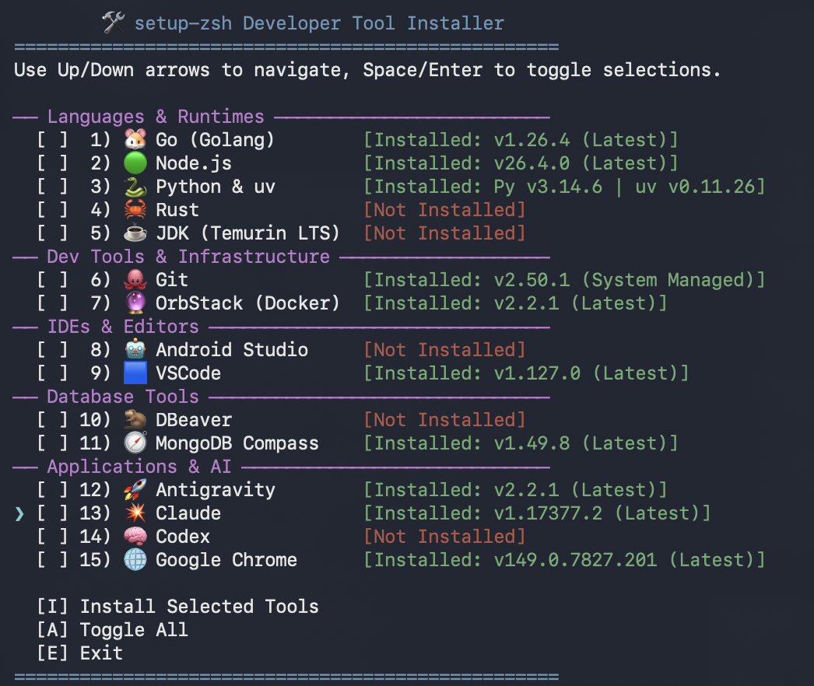

# setup-zsh

🌐 [English](README.md) | [Tiếng Việt](README_VI.md) | [简体中文](README_ZH.md) | [日本語](README_JA.md)

A lightweight Zsh setup for macOS. It gives you syntax highlighting, colorful file listings, a clean prompt, and **smart autosuggestions that match any part of your command history**.

Most Zsh setups only suggest commands that *start with* what you type. This one searches your *entire* history for any match and shows it with a `»` arrow.

## Install (One Command)

Open Terminal on any Mac and run:

```bash
curl -sSL https://raw.githubusercontent.com/openhoangnc/setup-zsh/main/setup.sh | bash
```

> The script only uses built-in tools (`curl`, `unzip`, `zsh`). You don't need Git or Xcode Command Line Tools.

Then apply the changes to your current terminal:

```bash
source ~/.zshrc
```

---

## What You Get

- **Smart Autosuggestions** — Commands you're starting to type are suggested first; if nothing starts with your text, your whole history is searched for it *anywhere* in a command, shown with a `»` arrow. Case doesn't matter (e.g., typing `GOOGLE` finds `curl -I google.com`).
- **History Search with Arrow Keys** — Type a keyword, then press **Up / Down** to scroll through every past command that contains it.
- **Syntax Highlighting** — Commands turn green if valid, red if not — in real time as you type.
- **Clean Prompt** — Shows `~/short/path (branch*) ↑1 ↓2 ❯`. Inside a Git repo, you see the branch name, whether you have uncommitted changes, and how many commits you're ahead/behind the remote. The arrow turns pink if the last command failed.
- **Auto-CD** — Type a directory path and press Enter. No need to type `cd` first.
- **Colorful File Listings** — Files and folders get distinct colors that look good on both light and dark backgrounds.
- **Better Defaults** — Case-insensitive Tab completion, smarter history (no duplicates), up to 100,000 commands saved, and everyday keys that just work (Home / End / Fn+Delete / Option+Arrow word jumps).
- **Dev Tools Installer (`install-dev-tool`)** — An interactive menu to install Bun, Go, Homebrew, Node.js, Python & uv, Rust, JDK (Eclipse Temurin LTS), Codex, gcloud CLI, Git, OrbStack, Android Studio, VSCode, DBX, MongoDB Compass, Antigravity, Claude, and Google Chrome — plus a **Global Packages** row that updates the packages installed *through* your package managers — npm, pnpm, Yarn, Bun, Homebrew, uv, pipx, RubyGems, Composer, and cargo — for whichever ones you have. Navigate with arrow keys, pick what you need.
- **Mac Cleanup (`cdm`)** — Installs [**CleanDevMac**](https://github.com/cleandevmac/cdm), my standalone cleanup tool (it started out in this repo). It reclaims disk space from regenerable developer caches and build artifacts (Xcode, Go, Node/npm/pnpm/yarn, Gradle, Maven, Cargo, Python, Homebrew, Playwright, and more), clears Electron/browser/app caches, sweeps project junk grouped per repo, reclaims Docker/Podman space, and surfaces leftover data from apps you've uninstalled — never deleting anything without an itemized confirmation.

---

## How to Use

### 1. Smart Autosuggestions

As you type, Zsh shows a faded suggestion from your history. Suggestions that **start with** your text are preferred; when nothing starts with it, the most recent command **containing** it is shown after a `»` arrow.

- **Starts with your text**: Type `curl` → see ` -I google.com` in gray. Press `→` or `Ctrl+F` to accept.
- **Contains your text**: Type `google` → see `» curl -I google.com`.
  - Press **`→`** or **`Ctrl+F`** to accept the whole suggestion.
  - Press **`Option+→`** (or `Alt+F`) to accept one word at a time.
- **Browse more matches**: Press **Up Arrow** to replace the line with another match, then keep pressing **Up / Down** to cycle through all matches.

> ⚠️ **Enter always runs exactly what you typed** — never the faded suggestion. To run a `»` suggestion, accept it first with `→` (or `Ctrl+F`), then press Enter.

### 2. Auto-CD

Just type a path and press Enter:
```bash
~/Downloads  # goes to ~/Downloads
..           # goes up one folder
```

> If a folder shares its name with a command (e.g. `test`), the command wins. Add a slash to force the cd: `test/`.

### 3. Git-Aware Prompt

- Shows `~/short/path (branch*) ↑1 ↓2 ❯ `. Long paths are automatically truncated.
- Pink `*` = you have unstaged changes. Green `+` = you have staged changes.
- Green `↑N` = N commits ahead of the remote (to push). Pink `↓N` = N commits behind (to pull). Hidden when in sync.
- Arrow `❯` turns pink if the last command failed.

### 4. Dev Tools Installer (`install-dev-tool`)

Run `install-dev-tool` to open an interactive menu.



- **Navigate**: Use **Up / Down / Left / Right** arrow keys to move the cursor (`❯`).
- **Select tools**: Press **Space** or **Enter** to check/uncheck a tool (`[ ]` ↔ `[✓]`), or type its number (for items 10–19, type both digits quickly). On the **Global Packages** row, **Enter** opens a per-manager breakdown instead of toggling — use **Space** or `19` to select it.
- **Actions (single line at bottom)**:
  - **Install**: Move to `[I] Install` and press **Enter** (or type `I`).
  - **Select all**: Move to `[A] Toggle All` and press **Enter** (or type `A`).
  - **Update all outdated**: Move to `[U] Select Outdated` and press **Enter** (or type `U`), or run `install-dev-tool --update-all` from your terminal (it exits when done).
  - **Quit**: Move to `[E] Exit` and press **Enter** (or type `E`, `Q`, `Esc`, or `Ctrl+C`).
- **CLI flags**: `install-dev-tool --help` lists all options (`-u/--update-all`, `-a/--all`).

**Good to know:**
- Bun installs via its official script (`https://bun.sh/install`) to `~/.bun/bin`.
- Go and Node.js install to `~/.local/` — no `sudo` needed, even for global npm packages.
- Homebrew installs via its official script (`https://raw.githubusercontent.com/Homebrew/install/HEAD/install.sh`) and configures `shellenv`.
- Python installs along with `uv` (Astral's fast Python package & project manager).
- JDK installs official Eclipse Temurin LTS release and configures `JAVA_HOME`.
- Desktop apps (VSCode, Claude, OrbStack, MongoDB Compass, DBX, Google Chrome, Android Studio, Antigravity) are downloaded and placed in `/Applications` automatically.
- A running app keeps running while its update downloads; it is closed only at the moment the new version is swapped in, then reopened. If the download fails, it is never closed. The app you are running the installer *inside* (e.g. VSCode's, Antigravity's or Claude's built-in terminal) is skipped with a warning — closing it would end the session — so update it from another terminal such as Terminal.app.
- Git is installed through Apple's official `xcode-select --install`.
- **Global Packages** (item 19) updates what your package managers installed, not the managers themselves. It covers every manager you have: npm (outdated globals reinstalled at `@latest`; `npm`/`corepack` are left to the Node.js tarball), pnpm (`update -g --latest`), Yarn Classic (`global upgrade --latest`), Bun (`update --global`), Homebrew (`update && upgrade`), uv (`tool upgrade --all`), pipx (`upgrade-all`), RubyGems (`gem update`, skipped for macOS's system Ruby), Composer (`global update`), and cargo (`install-update -a`, only when the `cargo-install-update` plugin is present). The row shows how many npm and Homebrew packages are outdated (the two that are cheap to poll); **press Enter on the row for a full per-manager breakdown** of what would change. After updating, each manager's cache is cleaned too (npm/Yarn `cache clean`, pnpm `store prune`, Bun `pm cache rm`, `brew cleanup`, uv `cache prune`, `gem cleanup`, Composer `clear-cache`) — best-effort, so a cleanup hiccup never fails the update.
- A run that only **updates** drops straight back to the menu. A first-time install waits for Enter first, so its setup notes stay readable — as does a run that reported an error.
- The installer checks for the latest versions automatically on startup.

### 5. Mac Cleanup (`cdm`)

Cleanup is handled by [**CleanDevMac**](https://github.com/cleandevmac/cdm) — my standalone tool, which grew out of this repo and now lives in its own. Setup downloads the latest release to `~/.zsh/setup-zsh/bin/cdm`; run it with `cdm` (the old `clean-my-mac` name still works).

[](https://github.com/cleandevmac/cdm)

It opens an interactive menu: it scans your Mac, groups everything it can safely reclaim into categories sorted biggest-first, and deletes only the ones you tick — developer caches and build artifacts, Electron/browser/app caches, project junk grouped per repo, Docker/Podman, and leftover data from apps you've uninstalled. You always see an itemized plan before anything is removed.

It also **runs standalone** — no need to install setup-zsh first:

```bash
curl -sSL https://github.com/cleandevmac/cdm/releases/latest/download/cdm | bash
# dry-run (look only, delete nothing):
curl -sSL https://github.com/cleandevmac/cdm/releases/latest/download/cdm | bash -s -- -n
```

The TUI keys, the full list of what it cleans, the safety guarantees, and the editable rule JSON are all documented in the [CleanDevMac README](https://github.com/cleandevmac/cdm#readme).

---

## Uninstall (One Command)

To remove everything and go back to your original settings:

```bash
curl -sSL https://raw.githubusercontent.com/openhoangnc/setup-zsh/main/uninstall.sh | bash
```

This will:
1. **Remove the setup-zsh config** from your `~/.zshrc` — your own custom aliases and settings are kept safe. If the file was created by this script and is now empty, it gets deleted.
2. **Delete the plugin folder** at `~/.zsh/setup-zsh/` — nothing else in `~/.zsh/` is touched.

---

## License

Licensed under the [MIT License](LICENSE).

Includes these third-party plugins in the `plugins/` directory:
- **zsh-syntax-highlighting** — [BSD 3-Clause License](plugins/zsh-syntax-highlighting/COPYING.md)
- **zsh-autosuggestions** — [MIT License](plugins/zsh-autosuggestions/LICENSE)
